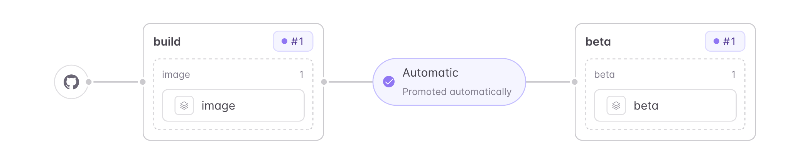

# Container image pipeline with Pulumi Delivery on Google Cloud

This example uses Pulumi Delivery to build a container image on every push, push it to Google Artifact Registry, and deploy it to Cloud Run in a beta stage. The image is built once: the beta stage deploys the exact image the build stage pushed, by digest, then checks that the service answers.



The example has three Pulumi projects, all in TypeScript:

- `pipeline/` defines the pipeline: a GitHub source, a `build` stage and a `beta` stage. Delivery keeps the pipeline itself up to date from this directory. In the `beta` stage, a Job runs `pipeline/check-url.sh`, which calls the service until it answers.
- `image/` creates an Artifact Registry repository, then builds `app/` and pushes it, tagged with the commit. It exports the image reference, pinned by digest.
- `beta/` deploys that image to a public Cloud Run service and exports its URL.

Every stack authenticates to Google Cloud through Pulumi ESC with OIDC, so no long-lived credentials are stored anywhere.

## Prerequisites

1. [Install Pulumi](https://www.pulumi.com/docs/get-started/install/), version 3.277.0 or later
1. [Install Node.js](https://www.pulumi.com/docs/intro/languages/javascript/), version 26 or later
1. A Pulumi Cloud organization with Pulumi Delivery available
1. A Google Cloud project with the Artifact Registry and Cloud Run APIs enabled
1. A GitHub repository that holds this example, for example a fork of `pulumi/examples`

## Setting up the pipeline

1. Give Pulumi Cloud access to your repository. Install the [Pulumi GitHub App](https://www.pulumi.com/docs/integrations/version-control/github-app/) on your GitHub organization if it isn't installed yet, then check that it can read the repository that holds this example: in Pulumi Cloud, go to **Settings** > **Version control**, open the GitHub installation, choose **Configure repository access**, and add the repository on GitHub.

1. Create an ESC environment that logs in to Google Cloud with OIDC. Follow [Configuring OIDC for Google Cloud](https://www.pulumi.com/docs/esc/integrations/dynamic-login-credentials/gcp-login/), then expose the credentials to the programs:

    ```yaml
    values:
      gcp:
        login:
          fn::open::gcp-login:
            project: <project-number>
            oidc:
              workloadPoolId: <pool-id>
              providerId: <provider-id>
              serviceAccount: <service-account-email>
      environmentVariables:
        GOOGLE_PROJECT: <project-id>
        GOOGLE_OAUTH_ACCESS_TOKEN: ${gcp.login.accessToken}
    ```

    `GOOGLE_PROJECT` must be the project ID, not the project number: Artifact Registry rejects project numbers. The service account needs these roles in the project: `roles/artifactregistry.admin` to create the repository and push the image, `roles/run.admin` to deploy the Cloud Run service and make it public, and `roles/iam.serviceAccountUser` on the service's runtime account, which is the Compute Engine default service account because the beta stack doesn't set one.

    The service account trusts each ESC environment by its exact name. If you reuse a workload identity pool and service account that already exist, grant this environment's subject `roles/iam.workloadIdentityUser` on the service account, following [Configuring OIDC for Google Cloud](https://www.pulumi.com/docs/esc/integrations/dynamic-login-credentials/gcp-login/).

1. Create the image and beta stacks, and import the environment into each one. Delivery only updates stacks that already exist.

    The project names in the three `Pulumi.yaml` files, the stack references in `pipeline/index.ts` and the Artifact Registry repository ID in `image/index.ts` are fixed. A second deployment in the same Pulumi organization, or in the same Google Cloud project and location, must change them first, or it fails with a 409 "already exists" error. Use your names in the commands below.

    ```bash
    cd image
    pulumi stack init <org>/gcp-ts-delivery-image-build-image/image
    pulumi config env add <project>/<environment> --yes
    cd ../beta
    pulumi stack init <org>/gcp-ts-delivery-image-build-beta/beta
    pulumi config env add <project>/<environment> --yes
    cd ..
    ```

1. Commit the two stack files. Delivery runs every program from your repository, so each stack's `Pulumi.<stack>.yaml` must be in git. In a fork of `pulumi/examples`, these files are ignored, so add them with `-f`:

    ```bash
    git add -f image/Pulumi.image.yaml beta/Pulumi.beta.yaml
    git commit -m "Add stack files for the Delivery example"
    git push
    ```

1. Create the pipeline stack, point it at your repository, and tell Delivery where the pipeline program lives, then commit and push everything:

    ```bash
    cd pipeline
    pulumi install
    pulumi stack init <org>/gcp-ts-delivery-image-build-pipeline/pipeline
    pulumi config set repository <owner>/<name>
    pulumi config set branch <branch>
    pulumi config set path <path>
    pulumi config set location <location>
    pulumi config set --path 'delivery:source.url' https://github.com/<owner>/<name>
    pulumi config set --path 'delivery:source.branch' <branch>
    pulumi config set --path 'delivery:source.directory' <path>/pipeline
    git add -f Pulumi.pipeline.yaml
    git commit -m "Point the Delivery pipeline at this repository"
    git push
    ```

    `repository` is your repository, as `<owner>/<name>`, and `branch` is the branch to watch. `location` is the Artifact Registry and Cloud Run location, for example `europe-west2`. `path` is this example's directory within the repository, for example `gcp-ts-delivery-image-build`. The example must live in a subdirectory: the pipeline starts runs for pushes that match `<path>/**`. With the example at the repository root (`path` of `.`), pushes update the pipeline but start no run.

    `pulumi install` installs the pipeline's dependencies, including the Delivery SDK, `@pulumi/delivery`, from npm.

1. Register the pipeline:

    ```bash
    pulumi delivery register
    ```

    Registration previews an update of the pipeline stack and asks you to confirm it. It ends with `warning: update has awaiting resources`. That is expected: the first stage waits for a run. For the same reason, the pipeline stack's update history shows the update as failed. Registration fails if the checkout has uncommitted changes or the commit is not on the branch in `delivery:source`.

1. Let the pipeline open the ESC environment. Registration creates a [service principal](https://www.pulumi.com/docs/delivery/concepts/identity/), named "Delivery gcp-ts-delivery-image-build-pipeline pipeline", and gives it write access to the pipeline, image and beta stacks. The stacks run as that principal, so it also needs to open the environment they import. In Pulumi Cloud, open the environment, go to **Settings**, then **Access**, choose **Add Principal**, then **Service Principal**, pick the pipeline's service principal and give it **Environment Open**.

    Or from the command line:

    ```bash
    ../scripts/pulumi-env-access-grant <project>/<environment> --principal "Delivery gcp-ts-delivery-image-build-pipeline pipeline" --by-name --permission open
    ```

1. Start the first run: push a change to a file in this example, or choose **Start a run** on the pipeline in Pulumi Cloud, under **Delivery** in your organization. Registration does not start a run.

1. Watch the run in Pulumi Cloud. The `build` stage pushes the image, and the `beta` stage deploys it to Cloud Run and checks that it answers. The run records the app's URL as the `beta-url` artifact of the release. From now on, every push that changes files in this example starts a new run.

## Cleaning up

Destroy the stacks in reverse order, then remove them:

```bash
cd pipeline && pulumi destroy && pulumi stack rm
cd ../beta && pulumi destroy && pulumi stack rm
cd ../image && pulumi destroy && pulumi stack rm
```

Destroying the beta stack deletes the Cloud Run service. Destroying the image stack deletes the Artifact Registry repository and every image in it. Destroying the pipeline stack removes the pipeline's service principal and its access to the environment.

If you created the ESC environment only for this example, remove it with `pulumi env rm <project>/<environment>`, along with any Google Cloud OIDC resources you created for it.
